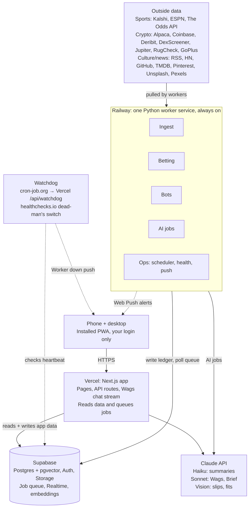
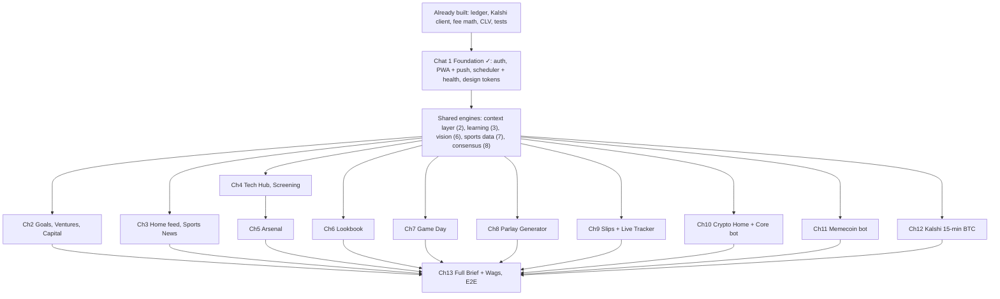

# Valemont Command — Master Plan

Oct 7, 2026 · @Terrell Sims · **Updated Oct 11, 2026: Chat 2 (Command core) complete**

## Build status

| Chat | Status | Closed |
| --- | --- | --- |
| Chat 1 — Foundation | **Done.** All four phases green, both monitoring drills passed | Oct 8, 2026 |
| Chat 2 — Command core | **Done.** All five phases live; first scheduled Morning Brief pushed at 09:45 | Oct 11, 2026 |
| Chat 3 — Learning engine, Home feed, Sports News | **Next.** Setup listed under Chat 3 in §6 | — |
| Chats 4–13 | Not started | — |

What changed from this plan during Chats 1 and 2 is recorded where it applies, marked **(as built)**. The repo's `CLAUDE.md` Current State holds the full detail: commits, test counts, drill timelines.

## Read first: six calls that shape everything

Verdict: build Valemont Command inside the existing valemont-agents repo, on free tiers except the Claude API (and Railway Hobby once the worker outgrows the free plan), and point the Betting pillar at a market-consensus engine instead of the old Kalshi models. The reasons follow.

**1. Your own repo already proved the Kalshi models don't beat Kalshi.** This is the most important finding of the audit. The `nfl_ml` walk-forward fit found no signal: its biggest possible adjustment was about 1.6¢ against the 3.1–4.3¢ a bet needs to clear fees. Both pre-registered props strategies failed their holdout, and by your own rule props stopped. Three outside builders measured the same thing and lost. Building the parlay generator on those models would print confident edges that don't exist.

**2. So the sharpest engine is market consensus, not a homemade model.** Each leg's probability starts from de-vigged sportsbook lines blended with the Kalshi mid. Edge = consensus probability − Kalshi price − Kalshi fee. That covers every sport Kalshi lists on day one, because any sport with sportsbook lines gets a number. Sport-specific models plug in later only after they pass a pre-registered holdout, the same discipline the repo already enforces. This is what practitioners running Kalshi bots actually do.

**3. Kalshi combos are quoted, not calculated.** There is no published leg cap. Each combo is priced live by market makers through a Request for Quote, eligibility turns on near game time, and coverage is mostly NFL and NBA. The generator therefore shows three prices per parlay: our correlated fair price, the naive product of leg prices, and a flag for whether every leg is combo-eligible. You pull the real quote in the Kalshi app. Ineligible slips are labeled "build manually."

**4. Kalshi needs no API keys to build any of this.** Market data is public and unauthenticated; the repo's client already reads it that way. Account verification only matters when you trade, and API keys only when you want quotes or orders pulled into the dashboard. Alabama has no state regulator action against Kalshi, but private class actions are pending there, so access risk sits in the risk register.

**5. The repo's "no real money, ever" rule must be amended before Chat 1.** CLAUDE.md §1 forbids any live execution. Your brief requires a paper/live switch on both bots. The amendment: paper by default; live only by an explicit owner flip per bot, with separate keys, hard limits and a kill switch. Kalshi bets and FOMO trades stay manual execution. **(as built)** Amended in Chat 1 Phase 1: only the core crypto bot on Alpaca is eligible for automated live execution; no key with withdrawal or transfer permission is ever stored.

**6. Crypto venues.** Core bot runs on **Alpaca**: identical paper and live APIs, crypto paper trading open in every state, keys already stubbed in `.env.example`. Memecoin bot uses **FOMO** for execution, but FOMO has no official API. So the bot paper-trades on DexScreener and Jupiter prices, and in live mode it pushes you the call to execute in FOMO, then logs your fill.

## 1. Repo decision

Build on `valemont-agents` and turn it into a monorepo: `apps/web` (Next.js) and `workers/` (the existing Python). Don't start over. The repo is about 16,700 lines of Python with an immutable commitment ledger, Kalshi fee math, CLV tracking, a pre-registration system, a Railway deployment that's already proven, and a 360-test invariant suite. That is the hardest part of a betting and trading track record, and it's already done right.

| Existing piece | Decision | Why |
| --- | --- | --- |
| `core/` (ledger, BaseAgent loop, orchestrator) | Keep as-is | Commit-before-outcome ledger becomes the backbone for bets, bot trades and 15-min BTC calls |
| `venues/kalshi/` (read-only client, fees, edge gate) | Keep, extend | Add combo/multivariate reads, sport discovery across all series, optional authenticated RFQ later |
| `db/001–017` migrations | Keep, continue numbering at 018 | Paper/live separation and immutability triggers already exist for ledger tables |
| `sports/nfl/` models | Keep as research only | Failed holdout; kept registered as forward tests, not used for picks |
| `adapters/crypto.py` | Replace strategy, keep plumbing | Mechanical placeholder rule; core bot gets a real strategy on Alpaca |
| `adapters/prizepicks.py` | Fold into Manual Slip Entry | No public PrizePicks API; screenshot parsing replaces the fragile fetch |
| `adapters/equities.py` | Retire | Not in the brief |
| `chief_of_staff` (planned) | Becomes the data layer behind Wags and the Morning Brief | Read-only reporter, which is exactly what Wags needs |
| `tests/`, `tests_live/` | Keep and extend to every new worker | They already caught two silent data-loss bugs |
| `dashboard/` (empty) | Replaced by `apps/web` | Nothing to carry |

**Two architecture rules in CLAUDE.md change.** First, the "dashboard never reads Supabase directly" rule: the Next.js app now reads Supabase server-side with your login, through read-only policies over the ledger. Workers stay the only writers to ledger tables. Second, database inspection.

**(as built)** The Supabase MCP is **not used in this repo at all**. The MCP connected in Cursor belongs to a different Supabase account. Instead, every inspection goes through `workers/scripts/db_inspect.py`, which connects only as the `valemont_readonly` role (db/018): SELECT on every table, no write grant anywhere, enforced by the database and covered by a live test. Migrations stay paste-by-hand. The repo is now laid out as `apps/web`, `workers/`, `db/`, `docs/`, with the Railway image built from `workers/` only.

## 2. Architecture

Vercel shows it, Railway runs it, Supabase remembers it. Your phone never calls an outside API directly, and nothing long-running lives on Vercel.

- **Reads:** pages are server components that read Supabase with your session. API routes handle writes (reactions, goals, slips, uploads) and drop heavy work into the `job_queue` table.
- **Work:** the Railway worker runs the repo's existing APScheduler loop, polls the queue every few seconds, and writes results back to Supabase.
- **Live screens:** Live Bet Tracker, Game Day and BTC 15-min subscribe to Supabase Realtime, so the phone updates without refreshing.
- **Wags:** chat streams from a Vercel route that calls Claude with the latest cross-pillar context snapshot plus the page you opened it from.
- **Alerts:** the worker sends Web Push straight to your devices; no third-party notification service.
- **Monitoring (as built), three layers:** the worker's own health monitor (job failures and stale jobs); an external watchdog (cron-job.org calls a token-protected Vercel route every 5 minutes, which pushes "Worker down" if the heartbeat is over 5 minutes stale); and healthchecks.io, which alerts by email if the watchdog itself stops calling.

## 3. Data model

One Supabase Postgres database, `public` schema, migrations continuing at `db/018`. The existing ledger tables stay the single source of truth for anything that wins or loses: generated parlays, played slips, bot trades and 15-minute BTC calls are all `commitments` with `legs` and `resolutions`. Everything else is ordinary app data.

**(as built) Migration numbering.** Applied: `db/001`–`012` and `db/014`–`020`. `db/013` (production roster, go-live) is deliberately unpasted. Chat 1 used: `018` read-only inspection role, `019` push tables, `020` shared tables plus ledger read policies, the TRUNCATE guard and grant lockdown. **Since then (from `migration_log`, 2026-10-12):** `db/021`–`041` are all applied: `040` venture taglines at 05:36:53 UTC and `041` the film/TV seed split at 21:59:10 UTC, both on Oct 12; `042` Sports News at 20:26:05 UTC on Oct 13 (second paste; the first failed in its self-test and applied nothing); `043` drop rules and the cross-in cap at 21:53:59 UTC on Oct 13; `044` broadcaster and league entities at 22:27:30 UTC on Oct 13; `045` the Tech Hub pillar at 02:32:51 UTC on Oct 14 (second paste; the first failed on the test source's slug and applied nothing). The per-file record is CLAUDE.md, Current State, "Migrations". `046` official tech decay and push eligibility at 02:57:59 UTC on Oct 14; `047` hid the 579 stories stored from late items at 04:45:18 UTC on Oct 14; `048` feed dates (undated items never push, the lead precision for the web, the backfill window) at 06:04:04 UTC on Oct 14; `049` GitHub repos (repos, append-only snapshots and surfacings, the cap and resurface rule by trigger) at 21:07:08 UTC on Oct 14; `050` the resurface rule's measured baseline at 21:12:56 UTC on Oct 14. `051` the Screening Room (the screening pillar, titles, title_trailers, append-only watch_status) at 01:35:19 UTC on Oct 15; `052` v_watch_current select-only at 01:49:29 UTC on Oct 15; `053` Screening Room recommendations at 19:36:32 UTC on Oct 15 (third paste; the first two failed in their own self-test fixtures and applied nothing). `054` the Arsenal (Chat 5 Phase 1: refs, words, drops, reactions, pool runs, the drop guard, the picker, the 27 seeds) at 04:36:56 UTC on Oct 16 (second paste; the first failed on a seed INSERT with 12 values for 14 columns and applied nothing). `055` the Arsenal's rooms in the picker, word seeds, one recorded re-verification, holds and item 11's two writes at 20:31:30 UTC on Oct 16 (second paste; the first failed when section 2's UPDATE fired a guard reading a table created later, and applied nothing). `056` Arsenal hold releases (append-only, once per hold), `v_arsenal_active_holds` and the picker on active holds at 21:07:36 UTC on Oct 16; holds 9–11 released after it. **Next new file: `db/057`.**

**Paper vs live, from day one.** Every money table carries `mode text not null check (mode in ('paper','live'))` with default `'paper'`, alongside the existing `is_test`. Capital Tracker, model stats and bot stats always group by `mode`, so live money never mixes with paper numbers and flipping a bot to live needs no schema change. **(as built)** `commitments` gained `mode` (default `'paper'`) and `origin` (default `'agent'`) in db/020; every existing row reads paper/agent.

**Row-level security.** App tables: RLS on, one policy `owner_id = auth.uid()` for select/insert/update/delete. Ledger tables: RLS on, a select-only policy for your user, no write policies. Workers write through the Postgres connection string, which bypasses RLS, so the frontend can read the ledger but can never edit a commitment. The immutability triggers from db/001–015 stay.

**(as built) Security additions in db/020:**
- `is_owner()` reads the single `app_settings` row, so no UUID is hard-coded in any policy.
- A TRUNCATE guard on all 19 append-only tables (row triggers never fire on TRUNCATE, so this was an open hole for every role, the worker included).
- `anon` holds no privilege on any public table, current or future; the signed-in role holds no write privilege on any ledger or archive table.
- Pattern for every new app table: RLS on, policies `TO authenticated` using `owner_id = auth.uid()`, anon revoked.

**Free-tier budget (500 MB).** Embeddings use 384 dimensions (about 1.5 KB per item). Unreacted news older than 90 days is pruned nightly; anything you reacted to is kept. Lookbook uploads are compressed to WebP in Storage (1 GB); Pinterest pins store URLs only. A nightly job logs table sizes and pushes an alert at 400 MB. **(as built)** The `db_size` system job runs daily at 03:00 Chicago and at every boot; it pushes once at 400 MB and once at 450 MB. Database size on Oct 8: about 15 MB.

**Open design question (not urgent):** `kalshi_candles` is immutable and TRUNCATE-proof, so the "retention window" below can't be a plain delete. When storage gets tight, it needs a deliberate design (archive and drop by partition, or a pre-registered exception), never a weakened guard.

### Existing tables carried over

| Table | Role in Valemont Command |
| --- | --- |
| `agents`, `runs`, `events` | Every bot, generator and job is an agent; `events` feeds the activity stream |
| `commitments`, `legs`, `resolutions` | Parlays, played slips, bot trades, BTC 15-min calls. Gains `mode` and `origin` columns |
| `selections`, `commitment_factors`, `closing_snapshots` | Per-leg reasoning and CLV, already built |
| `resolution_attempts` | Void-rate health metric per agent |
| `kalshi_markets`, `kalshi_candles`, `kalshi_trades`, `kalshi_settlements` | Market archive; candles get a retention window to protect the 500 MB cap |
| `model_versions`, `preregistrations` | Any future sport model must pass through these before it's used for picks |
| `briefs` | Morning Brief storage |

### New tables

Rows marked **built** exist as of Chat 1.

| Domain | Table | Key columns |
| --- | --- | --- |
| Shared | `app_settings` **built** | owner\_id, timezone, notification prefs, seed interests (jsonb); exactly one row |
| Shared | `push_subscriptions` **built** | endpoint, p256dh, auth, device\_label, active, last\_success\_at |
| Shared | `notifications` **built** | kind, title, body, deep\_link, sent\_at, status, error |
| Shared | `job_health` **built** | job, expected\_interval\_s, last\_ok\_at, last\_error, consecutive\_failures, alert\_state |
| Shared | `ai_usage` **built** | purpose, model, tokens\_in, tokens\_out, cache tokens, batch, cost\_usd, critical, created\_at (append-only) |
| Shared | `job_queue` **built** | kind, payload, status, attempts, run\_after, locked\_at, last\_error |
| Learning engine | `sources` | pillar, name, kind (rss / github / api; Reddit dropped, §4), url, weight, active |
| Learning engine | `content_items` | pillar, source\_id, external\_id, url, title, ai\_summary, published\_at, tags\[\], embedding vector(384); unique (source\_id, external\_id) |
| Learning engine | `reactions` | item\_id, reaction (love / neutral / not\_interested), created\_at |
| Learning engine | `interest_profiles` | pillar, profile\_vector, topic\_weights, source\_weights, updated\_at |
| Home | `goals` | title, horizon (weekly / long\_term), week\_start, status, carried\_from, completed\_at |
| Home | `calendar_cache` | event\_id, starts\_at, title (refreshed each morning) |
| Wags | `wags_threads` | title, origin\_page, created\_at |
| Wags | `wags_messages` | thread\_id, role, content, context\_refs (jsonb) |
| Wags | `context_snapshots` | built\_at, payload (jsonb summary of every pillar) |
| Ventures | `ventures` | name, stage, status, next\_action, blockers, archived\_at |
| Ventures | `venture_dates` | venture\_id, label, due\_on |
| Ventures | `venture_log` | venture\_id, entry, created\_at |
| Capital | `bankroll_entries` | mode, kind (deposit / withdrawal / adjustment), amount, note |
| Capital | `crypto_holdings` | mode, asset, qty, cost\_basis |
| Capital | `capital_snapshots` | date, mode, source, value (written nightly; history chart reads this) |
| Arsenal | `arsenal_refs` | category, title, origin, meaning, deploy\_line, room, source\_title\_id |
| Arsenal | `arsenal_drops` | date, ref\_ids\[\], power\_word, power\_word\_deploy\_line |
| Arsenal | `arsenal_saved` | ref\_id, saved\_at |
| Arsenal | `arsenal_quiz_attempts` | week\_start, ref\_id, correct |
| Screening | `titles` | tmdb\_id, kind (movie / tv), name, release\_date, providers (jsonb), trailer\_key, content\_item\_id |
| Screening | `watch_status` | title\_id, status (want / watching / finished), finished\_at |
| Lookbook | `lookbook_items` | origin (pinterest / upload / discovery), external\_id, image\_url, storage\_path, board, ai\_tags (jsonb), colors\[\], embedding |
| Lookbook | `lookbook_categories`, `lookbook_item_categories` | name, sort; item\_id, category\_id |
| Lookbook | `style_dna` | summary, palette, suggestions (jsonb), built\_at |
| Lookbook | `oauth_tokens` | provider, access\_token, refresh\_token, expires\_at (encrypted with pgsodium or app-side) |
| Tech Hub | `repos` | full\_name, stars, stars\_7d, topics\[\], why\_it\_matters, content\_item\_id |
| Sports | `sports_events` | league, espn\_id, kalshi\_event\_ticker, starts\_at, home, away, broadcast, status, score (jsonb) |
| Betting | `slips` | commitment\_id, origin (generated / analyzed / manual), venue, tier, stake, payout, mode |
| Betting | `slip_uploads` | storage\_path, parsed (jsonb), confirmed\_at, slip\_id |
| Betting | `leg_live_state` | leg\_id, current\_value, line, period, live\_prob, status (hit / on\_pace / danger / dead), updated\_at (latest row only) |
| Crypto | `bots` | kind (core / meme / btc15), mode, enabled, risk\_limits (jsonb), last\_heartbeat |
| Crypto | `bot_learnings` | bot\_id, insight, evidence (jsonb), created\_at |
| Crypto | `equity_snapshots` | bot\_id, mode, ts, equity |
| Crypto | `token_screens` | chain, mint, liquidity\_usd, rug\_flags (jsonb), passed, screened\_at |
| Crypto | `accumulation_signals` | asset, date, call (accumulate / hold / wait), reasoning, metrics (jsonb) |
| Crypto | `btc15_positions` | commitment\_id, entered\_price, entered\_at, exited\_price, exited\_at |

`job_queue` carries work the app hands to Railway: slip parsing, Arm Me requests, Lookbook tagging, on-demand parlay runs. **(as built)** The worker claims jobs with `FOR UPDATE SKIP LOCKED` every 10 seconds, retries with backoff, and fails a job after 5 attempts. Only a `noop` handler exists so far; each pillar adds its own.

Views the app reads: `v_model_performance` (hit rate, ROI net of fees and CLV by tier, sport, mode), `v_capital_today` (totals and breakdown by source and mode), `v_open_exposure` (every open leg by game, never summed across agents).

## 4. API and services inventory

**(as built) Expected spend is about $5–25/month:** Railway Hobby from Oct 13 ($5 a month including $5 of usage; the feed took the worker from about 40 MB to about 130 MB at rest, past the Free plan's $1 credit) and the Claude API (starting with $5 prepaid and a **$20 monthly cap**, owner decision Oct 9; it was $10). Everything else runs on free tiers. Original estimate, for when the full build is running: about **$40–60/month**, with Railway Hobby (about $7–10) and the Claude API (about $30–50). The Claude API has no free tier, and a Claude Pro subscription doesn't cover API usage.

**How the Claude estimate is built.** **Re-sized Oct 14 (owner): about 1,300 stories a day is the new normal**, measured on production: kept new stories 941 (Oct 11), 1,289 (Oct 12), 1,265 (Oct 13), about 1,550 items a day, summarized by direct Haiku calls of about 7 stories each (483 calls for 3,303 stories in 72 h). Measured cost: `feed_summarize` $0.18 on Oct 13 (307 calls, including a backlog), so about $3–6 a month for summaries; month-to-date AI spend on Oct 14 was $0.47 of the $20 cap. Detail: `docs/feed_ranking.md`, "Daily volume". The original assumption was about 300 summaries a day on the Haiku tier through the Batch API (about $5), Wags at about 20 messages a day on Sonnet 5.5 with prompt caching (about $14), and the Morning Brief, Arsenal, slip parsing, Lookbook tagging and bot reasoning together at about $15. Every call is logged to `ai_usage`, and a budget guard downgrades non-critical calls to Haiku if the month runs hot. **(as built)** The guard lives in `workers/core/ai.py`, the only file allowed to call Claude: at 80% of `AI_MONTHLY_BUDGET_USD` (code default $10; the owner set **$20**, Oct 9) non-critical calls downgrade to the cheapest model; at 100% they're refused; one push per threshold per month. The web side gets a TypeScript twin in Chat 2, reading the same table.

### Core platform

| Service | Used for | Tier and limits | $/mo | Account or key | Fallback |
| --- | --- | --- | --- | --- | --- |
| Vercel | Next.js app, API routes, watchdog route | Hobby, free (personal use). **Live at `valemont-command.vercel.app`**; builds only when `apps/web` changes | 0 | Vercel account linked to GitHub; env: Supabase URL, publishable key, `OWNER_USER_ID`, VAPID keys, `SUPABASE_SECRET_KEY` (watchdog only), `WATCHDOG_TOKEN`, `WATCHDOG_PING_URL` | Cloudflare Pages |
| Supabase | Postgres, Auth, Storage, pgvector, Edge Functions | Free: 500 MB DB, 1 GB storage, pauses after 7 idle days (the heartbeat prevents it) | 0 | Existing project; publishable key (browser), a dedicated `vercel-watchdog` secret key (server, one route), Session pooler URL, read-only role URL | Pro at $25 if the cap is hit |
| Railway | All Python workers and the scheduler | **Hobby from Oct 13 (owner):** $5/month including $5 of usage. Free ($1 credit, 0.5 GB per service) until then: the system-jobs-only worker used about 45–50 MB; with the Chat 3 feed it rests at about 130 MB with ingest peaks about 155 MB (Oct 13), about $1.27/month of memory alone at about $10 per GB-month, past the $1 credit | 5 | Existing account | Fly.io or Render |
| Claude API | Summaries, vision, Brief, Wags, Arsenal, reasoning | Pay as you go | Start: $5 prepaid, $20 cap (Oct 9; was $10) | Console API key with a monthly spend limit set (Chat 2) | Haiku-only mode via budget guard |
| Embeddings | Learning engine, Lookbook similarity | Supabase built-in gte-small (384-dim) in Edge Functions, free | 0 | None | sentence-transformers on Railway |
| Web Push | All push alerts | Self-hosted VAPID: `web-push` on Vercel, `pywebpush` on the worker, free. **Proven on a locked iPhone from both senders** | 0 | VAPID key pair in Vercel and Railway | Email digest |
| cron-job.org **(added)** | Calls the watchdog route every 5 minutes | Free | 0 | Account; job sends `Authorization: Bearer WATCHDOG_TOKEN` | GitHub Actions cron |
| healthchecks.io **(added)** | Dead-man's switch: emails if the watchdog stops pinging | Free Hobbyist; 5-minute period, 5-minute grace | 0 | Account; ping URL (secret) | Second cron-job.org job |

### Betting and sports

| Service | Used for | Tier and limits | $/mo | Account or key | Fallback |
| --- | --- | --- | --- | --- | --- |
| Kalshi REST and WebSocket | Markets, prices, combo-eligible events, settlement | Public and unauthenticated for reads; limits undocumented, repo already backs off on 429 | 0 | None now; RSA API key later for RFQ quotes and your portfolio | Odds aggregators that carry Kalshi prices |
| ESPN site API (unofficial) | Schedules, live box scores, broadcasts, mainline odds | Free, no key, can change without notice | 0 | None | API-Sports free tier |
| The Odds API | Sportsbook lines for consensus on props and sports ESPN lacks | Free tier about 500 credits/month (approximate, verify at signup) | 0 | API key | Paid tier about $30 if consensus needs more coverage |
| nflreadpy, nba\_api, Fast-F1, pybaseball | Player and team stats for live probability and future models | Free libraries | 0 | None | ESPN stats |

### News, culture and tech

| Service | Used for | Tier and limits | $/mo | Account or key | Fallback |
| --- | --- | --- | --- | --- | --- |
| Publisher RSS | Home feed, Sports News, crypto news | Free; Bloomberg and The Information give headline and teaser only | 0 | None | Google News RSS query per source |
| ~~Reddit API~~ **Dropped Oct 13 (owner)** | ~~r/ClaudeAI, r/OpenAI, r/LocalLLaMA~~ | Reddit closed self-service access to the public Data API on Nov 11, 2025: new OAuth tokens need approval, and practitioners report denials for personal scripts. Source: Reddit's r/redditdev announcement "Introducing the Responsible Builder Policy + new approval process for API access" (Nov 11, 2025; thread 1oug31u). **Verified by the planning chat, 2026-10-13** | 0 | None | None; Hacker News is Tech Hub's community source |
| Hacker News (Algolia) | Tech Hub | Free | 0 | None | HN Firebase API |
| GitHub REST | Trending and most-starred repos | 5,000 requests/hour with a token | 0 | Personal access token | Search sorted by recent stars |
| TMDB | Titles, release dates, trailers, where to stream | Free with attribution | 0 | API key | OMDb |
| Pinterest API v5 | Boards and pins sync | Free; trial access gives read scopes, but approval has taken weeks for many developers ([forum](https://community.pinterest.biz/t/update-developer-app-approvals/45527?page=4)). **Applied Oct 8 (Personal API access), trial access pending** | 0 | Business account plus developer app | Public board RSS feeds |
| Unsplash, Pexels | Lookbook discovery feed | Free: about 50 and 200 requests/hour | 0 | API keys | Each other |
| Google Calendar | Morning Brief highlights | Free | 0 | Google Cloud OAuth client | Paste an ICS link |

### Crypto

| Service | Used for | Tier and limits | $/mo | Account or key | Fallback |
| --- | --- | --- | --- | --- | --- |
| Alpaca | Core bot paper and live execution, crypto data | Paper crypto open to every account in every region ([docs](https://alpaca.markets/learn/getting-started-with-alpaca-crypto-api)) | 0 | Separate paper and live key pairs | Coinbase Advanced |
| CoinGecko Demo | Long-term prices | Free, rate-limited | 0 | Demo key | Coinbase public candles |
| Coinbase public candles, Deribit DVOL | BTC spot proxy and volatility for the 15-min model | Free | 0 | None | Kraken public API |
| DexScreener | Memecoin pairs, liquidity, volume | Free, no key | 0 | None | Birdeye free tier |
| Jupiter | Meme price quotes for realistic paper fills | Free tier | 0 | Portal key | DexScreener price |
| RugCheck, GoPlus | Rug, honeypot and mint-authority checks | Free | 0 | None or free key | Each other |
| alternative.me, CoinMetrics community | Fear and Greed, cycle metrics for accumulation signals | Free | 0 | None | blockchain.com charts API |
| FOMO | Your manual memecoin execution | No official public API ([Bitquery note](https://docs.bitquery.io/docs/blockchain/Solana/fomo-api/)) | 0 | Your app account | Jupiter auto-execution if you ever want it |

## 5. Dependency map

Nothing gets built before what it stands on: Foundation first, then the five shared engines, each arriving one chat before the first pillar that needs it.

The one cross-pillar link to watch is Screening Room into the Arsenal: finished shows feed Arsenal cards, which is why Screening (Chat 4) lands before the Arsenal (Chat 5).

## 6. Build sequence

Thirteen build chats after this one, each split into phases with a test you run yourself. Frameworks come first (auth, push, scheduler, context layer, Morning Brief), so every later pillar plugs into Wags and the Brief the day it ships. The first version is done only when Chat 13's end-to-end test passes with all 16 pillars live.

**Every chat follows the same contract:** read this plan and CLAUDE.md, ask questions, search GitHub, deliver phased Claude Code prompts, list keys needed, and close with all checkboxes ticked. Every new worker also registers a Wags context provider and a Morning Brief section in the same chat.

**(as built) Working rules added during Chat 1, all in CLAUDE.md §6:**
- Native Windows PowerShell 5.1: no `&&`, `||`, ternaries or `??`.
- No secret values ever printed in any tool output.
- Never use another account's CLI session (Vercel, Railway, GitHub) for this repo.
- Merge PRs with a merge commit, not a squash.
- Reports back to the planning chat get filled in honestly; anything not actually checked is recorded as pending, never as passed.

### Chat 1 — Foundation ✅ Done Oct 8, 2026

**Set up in this chat (as built):** Supabase keys (publishable, plus a dedicated `vercel-watchdog` secret key), Vercel, VAPID keys, cron-job.org, healthchecks.io. **Changed from plan:** Railway stays on the free plan instead of Hobby; the Anthropic API key moves to Chat 2 (the budget guard was built and tested with stubbed calls, no spend).

1. Repo restructure and rules: `apps/web` + `workers/`, CLAUDE.md amended (§1 live-money rule, §5 frontend reads).
   - [x] Both test suites green after the move (tests 360, tests\_live 88; pre-registration hashes unchanged)
   - [x] Railway worker redeploys from the new path (root `/workers`, config `/workers/railway.json`, watch pattern `/workers/**`)
   - Also: db/014–018 pasted (ledger mutation gaps closed); read-only inspection role replaced the MCP; Railway clock offset measured for the first time (+30 ms); a canary crash bug found and fixed; database password rotated.
2. Next.js app, Supabase Auth (your login only), design tokens extracted from your inspo screenshots.
   - [x] Login works on phone and desktop; any other account is rejected (stranger account tested, then deleted)
   - [x] Tokens file drives every color, font and spacing value; no default shadcn grays (`check:tokens` and `check:contrast` in lint)
   - Design system: Night (default, River Styx / Carbon Fibre / Amber Autumn) and Day (coconut cream); Instrument Serif, Geist, Geist Mono, one pixel face for the boot screen and 404. Next.js 16, Tailwind v4, `proxy.ts`.
3. PWA shell and push: manifest, service worker (Serwist), VAPID keys, onboarding screen.
   - [x] Installed to iPhone Home Screen; test push arrives with the phone locked (from both the app and the worker)
   - Also: `@serwist/turbopack`; no signed-in page ever cached on the device; offline screen works in airplane mode.
4. Shared tables (built as db/020), consolidated worker scheduler, `job_health`, `ai_usage`, budget guard.
   - [x] A deliberately failing test job triggers a push after two misses (Drill 1: alert about 92 s after boot, then "Recovered")
   - [x] **Added:** kill the worker, get "Worker down" from the external watchdog, restart, get "Worker back" (Drill 2: passed on rerun, first stale call, every cron call 200)
   - Also: worker now runs system jobs with zero agents (heartbeat, health monitor, db size, job queue); canary retired; watchdog fault isolation fixed after Drill 2's first run exposed two 500s.

**Carried out of Chat 1:**
- Railway trial ends about Oct 18. Decision: stay on Free. When the trial lapses the worker stops, the watchdog pushes "Worker down", and it gets redeployed by hand. Confirm with the 24-hour usage figures (due Oct 9).
- "JWT issued at future" (clock skew inside Supabase, between its API gateway and PostgREST, not the caller) shows up occasionally; the watchdog retry absorbs it. Escalate to Supabase only if 503s appear in the watchdog logs.
- Pinterest trial access pending. On approval, move the privacy URL to `https://valemont-command.vercel.app/privacy`.

### Chat 2 — Command core ✅ Done Oct 11, 2026

**Set up in this chat (as built):** Anthropic API key on Railway, Vercel (Production) and the root `.env` (Oct 10); $20 monthly budget (owner decision Oct 9; was $10). **Changed from plan:** the Google Calendar project is deferred (owner, Oct 9); seven ventures seeded, not nine (NCLEXCompass and Senior Care Systems dropped).

1. Goals (weekly and long-term, Monday reset, carry-over, history). PR #8.
   - [x] Unfinished goals carry to the next week automatically **(Oct 9: production rollover returned 1, then 0; the carried copy landed in week 2026-10-05)**
2. Ventures HQ (seven ventures seeded, detail view, append-only running log, dates). db/022–023.
   - [x] A venture item due today appears in the Today list **(Oct 9: owner's Phase 2 phone checklist, all green; Home TODAY reads `v_venture_today`)**
3. Capital Tracker on paper data, labeled PAPER, with history (daily `capital_snapshots`). PR #14.
   - [x] A paper bankroll entry shows in the total and the breakdown **(Oct 10: owner's signed-in `capital.spec` 9/9)**
4. Context layer and Wags: page-aware floating button, saved threads, provider registry. Includes the TypeScript twin of the AI budget guard. PR #16.
   - [x] Wags answers "what's due this week" from real venture and goal data **(Oct 10: owner's real call, `ai_usage` 70, snapshot 19)**
5. Morning Brief generator on Railway, sections that switch on as pillars register. PRs #20, #21.
   - [x] A brief generates at the scheduled time and arrives as a push **(Sun Oct 11: brief 173 generated 06:15 Chicago, Sonnet, 185 words, `ai_usage` 84 at $0.010789; delivery 45 / notification 134 sent 09:45:02, not late; owner confirmed arrival on the phone)**
   - Also: silent Wags proposals fixed (a generated "Proposing: …" line when a turn ends with no text); one shared Wags voice file; server actions return readable refusals instead of throwing; a zero-attempt void/missed invariant added in the database (db/024–025).

**Carried out of Chat 2:**
- ~~Goals' first real Monday~~ **Done Mon Oct 12** (the last carried item; read via `db_inspect`): `goals_rollover` ran 00:01:00 Chicago (05:01:00 UTC, ok 05:01:01, 0 failures) and carried the 3 weekly goals still open in week Oct 5 into week Oct 12 (carry_count 1); `goals_monday_push` ran 07:00 Chicago and notification 206 "Set your week" was sent 12:00:01 UTC, no error. The owner confirmed it arrived.
- Railway trial ends about Oct 18; redeploy the worker by hand on Free.
- ~~The silent-proposals before/after token comparison~~ **Done Oct 11:** message 260 has a model-written sentence before its proposal and no reasoning part, 254 output tokens against message 188's 544 with no text.

### Chat 3 — Learning engine, Home feed, Sports News ✓ (closed Oct 13; carried items below)

**Set up in this chat:** nothing new; RSS needs no keys.

1. Source registry, RSS ingest, dedupe, Haiku batch summaries, embeddings.
   - [x] All 13 seed sources ingest; every item shows a summary and the original link. **GREEN Oct 13 (owner, 13:28 Chicago)** on the owner's criterion: For you page one is summarized, not the whole backlog. Read via `db_inspect` at 18:27 UTC: `feed_for_you` page one (30) has 30 of 30 summaries on Home and 29 of 30 on Sports; the one without (story 527) was retired as headline-only after 2 failed tries, as designed.
     - **Worker RAM after the Phase 1 hotfix** (`job_health` RSS notes; boot 02:54:57 UTC Oct 13): 74 MB at boot; 129 MB at +2 h 10 m (nearest to +3 h); 133 MB at +5 h 05 m (nearest to +6 h); 130 MB at rest at 18:27 UTC (+15.5 h), 155 MB peak during an ingest, returned after it. Slope from +2 h to the latest reading: about +0.07 MB an hour, flat within rounding. From Oct 13 every job's log line carries its RSS note, so Railway keeps the history `job_health` overwrites.
     - The Oct 12 Step 7 report: `docs/feed_checks/report-2026-10-13/`.
2. Love / Neutral / Not Interested, interest profile, daily re-rank, seeded interests.
   - [x] Reactions visibly move the ranking. **Closed Oct 12 by the owner** on three grounds (design and record: `docs/feed_ranking.md`, owner decision 7):
     1. **The live Not Interested movement:** after 4 Not Interested taps on the topic, the held-out story went 64 → 159 against the control's 86 → 99, a net −82. **Not pre-registered:** the frozen check was the Love direction, which FAILED both its conditions because the run had 1 Love, not 10.
     2. **The Love unit test passes:** `tests/test_feed_rank.py` `TenLoves`, under the owner's amended rule (held-out 50 → 35 against control 51 → 62; the topic on page one 6 → 12). `TenNotInterested` holds the other direction.
     3. **⏰ Owner watch, due Sun Oct 19:** one week of Love effects on /settings/feed. Open until then.
   - Also Oct 12: db/041 split the film/TV love seed. Hollywood and US dealmaking and the major festivals are loves; international and regional TV/film markets are not interested.
3. Sports News for CFB, NFL, NBA, F1 and Golf on the same engine.
   - [x] Filter chips by sport; reactions train the sports profile separately. **GREEN Oct 13 (owner, 17:08 Chicago):**
     - `e2e/sports.spec.ts` (owner, phone): the chips keep their choice in the URL through the tabs; a chip shows only its sport; **a Love on /sports writes pillar `sports` only, never `home`** (`storyReactions` reads back `[{pillar: sports, reaction: love}]`); a confirmed move updates the player's current team; a test move is invisible without the e2e marker. Owner: GREEN.
     - Owner screenshot review of /sports (All, golf), /settings/feed (a proposed move), /news (All, deals) and Home's short feed, both themes, phone and desktop: approved (after the 16:39 fixes).
     - The read path: db/042 (sport chips filter before ranking, event boosts, the per-follow entity cap on Sports page one, move proposals; applied Oct 13 20:26:05 UTC) and db/043 (the cross-in cap: /news is Home's pillar only, Home's top 10 at most 2 tier-1 sports stories; applied 21:53:59 UTC). `tests_live -v` on the merge: 318 OK, 0 skipped.
     - **Scope addition, /news with category chips** (owner, Oct 12): `e2e/news.spec.ts` 4/4 (owner, before the cross-in cap); categories shipped as recorded in `docs/feed_checks/recategorize-2026-10-13-final/README.md` (93 Haiku calls, $0.046755 for the day).
     - **Merged:** PR #27, merge `922e22d`. Live Oct 13: Railway deployment of `922e22d` (worker boot 22:22:05 UTC; `feed_ingest`, `feed_summarize`, `feed_score`, `feed_why` ok, 0 failures); Vercel production `valemont-agents-6uvmhe1s9` Ready 22:20:56 UTC on `valemont-command.vercel.app`. Logged out, /, /news, /sports and /settings/feed redirect to sign-in; the pages' reads on production data (db_inspect): Home 31 rows with 2 cross-ins in its top 10, /news 0 cross-ins at any position, /sports and its golf chip a full page.

**Chat 3 close-out (Oct 13).** Every checklist item above is GREEN with its evidence. Migrations this chat: `db/032`–`db/043`, all applied and recorded (CLAUDE.md, Current State); `db/044` (broadcaster and league entities) is the close-out follow-up. Carried items, with dates:

- **Sun Oct 19:**
  - the owner's one-week watch of Love effects on /settings/feed (Phase 2, owner decision 7);
  - the shadow `drop` review: the Oct 12 report found ~17% of non-none labels wrong, 3 of them a love (yachts); likely retire the shadow classifier rather than turn it on;
  - a watch on duplicate merges of the Skins Game kind (one event, several stories). **Added Oct 14 (owner): cross-source clustering of official tech items.** OpenAI's usage-tier change arrived as two separate stories: 8317 from `openai-api-changelog` ("Simplified API usage tiers from five to three…", dated Oct 6) and 8941 from `openai-community-announcements` ("Update to OpenAI API Rate Limits", Oct 6 18:41 UTC). One launch can come in through the changelog, the community and the SDK feeds at once; look at why they don't cluster. Both retired from Tech For you on db/048's backfill window, so nothing is on screen now. No code before the review.
  - **Added Oct 14 (owner): repo why lines that pass only by naming Claude Code**, with no concrete action (day one: universal-modder, "agent-driven workflows in Tsims's Claude Code setup"). If it is a pattern, the dev-workflow target needs "names what it would do", not just "names the tool" (`docs/tech_hub.md` §7.2b). No change before the review.
- **Mon Oct 20:** the NFL props archive moves to Supabase Storage: design it (Step 0) before week 6 is archived. Week 5's candles and prints took ~34 MB; weeks 5–18 at that rate are ~470 MB, the whole 500 MB tier (CLAUDE.md, RECURRING).
- ~~**Owner decision, made Oct 13:** a free Supabase staging project for migration dry runs.~~ **Reversed Oct 13 (owner, Chat 4 planning): no staging project.** Migrations stay paste-to-production; the rolled-back self-test DO block is the guard, and db/042's lesson stays in CLAUDE.md §5 (a TRUNCATE assertion names every referencing table).

### Chat 4 — Tech Hub and Screening Room

**Set up in this chat:** GitHub fine-grained token, public read only (Phase 2); TMDB API key (Phase 3). ~~Reddit script app~~: dropped (§4).

0. ~~**Step 0: the Supabase staging project.**~~ **Struck Oct 13 (owner, Chat 4 planning): no staging project**; migrations stay paste-to-production (CLAUDE.md §5).

**Owner decisions, Oct 13 (Chat 4 planning):**
- Reddit is dropped from Tech Hub: Reddit closed self-service Data API access on Nov 11, 2025 (§4, with the source).
- Tech Hub ingests on the existing 30-minute feed cycle.
- Tech Hub pushes only for free credits and promos, at most 3 per Chicago day.

1. Tech Hub: official changelogs and Hacker News (Phase 1), GitHub trending with a "why this matters to you" line (Phase 2; its repos migration takes the next free number, since db/045–048 went to Phase 1's fixes).
   - [x] A new Claude or OpenAI release shows up within one ingest cycle. **Phase 1 GREEN Oct 14 (owner)**, with three watch items that do not block Phase 2 (below): two closed Oct 14, one pending. The feed path met it: `-m scripts.tech_latency` at 06:10 UTC Oct 14 showed 3 releases first seen after deploy (claude-code v2.1.299 24.4 min, openai-python v3.30.0 12.7 min and v3.31.0 13.3 min), 0 over the limit.
     - **Owner checks, Oct 14:** `e2e/tech.spec.ts` on phone 7/7 pass; the screenshot gate on phone and desktop, both themes, approved; the forced test push (`-m scripts.tech_test_push`) arrived with the phone locked and opened the story: notification 353 ("Free credits (test): Update to OpenAI API Rate Limits", `/tech/story/8941`, sent 06:07:03 UTC, no error), `tech_credit_pushes` row 76 `is_test`, so it used none of the day's 3 real pushes.
     - **Watch items (do not block Phase 2; two closed by the owner Oct 14, one pending):**
       1. **CLOSED GREEN (owner, Oct 14), with a caveat.** Page-watcher latency: the first anthropic.com/news, claude.com/blog or openai.com/news post first seen after deploy. None yet at 06:10 UTC Oct 14. At 20:25 UTC (`-m scripts.tech_latency --since 2026-10-14T06:22:00Z`): anthropic-news 2 and claude-blog 1, all first seen on the stated day (date-only sources); openai-news 1 date-only pass and 3 over 30 min (Third Moment Research 533 min, Amp 323, SentinelOne 383), with published times exactly 07:00, 12:00 and 12:00 UTC. The source fetched every 30 min with 0 failures, so the lag is attributed to the source's scheduled timestamps, not the worker. **This is an inference, recorded as one:** what each earlier fetch contained was not logged. Phase 2 adds each fetch's newest 3 item GUIDs to its INFO log line so the next late item can be checked against earlier fetches.
       2. **CLOSED (owner, Oct 14). New baseline for Phase 2: 138 MB at rest.** Worker memory at rest against ~130 MB, from the Railway log RSS lines; due after 08:50 UTC Oct 14. **Read 20:25 UTC Oct 14** (deployment `4fce67ec`, boot 06:22:38 UTC; all 6,902 `valemont.jobs` RSS lines since boot, 843 heartbeats, one a minute, none missing): 75 MB at boot; at rest 126–129 MB from 07Z to 14Z, then two steps, +5 MB at the 14:45 `morning_brief_push` and +4 MB at the 15:25 ingest, to 136–138 MB; 134 MB before the 20:22 ingest. Ingest peak 146–156 MB to 14:54, then 154–168 MB, highest **168 MB at 15:55**, back to 134–139 MB after every run. Slope (OLS on heartbeats): +1.06 MB/h from 07Z, which is the two steps; **−0.19 MB/h since 15:30Z**, flat. Against the baseline: at rest +4 to +8 MB, peak +13 MB. The owner's reading: flat, returns after ingest; the +5/+4 MB steps are one-time loads.
       3. **PENDING:** the why-it-matters Haiku cost for one full Chicago day. Oct 14 Chicago ends 05:00 UTC Oct 15; not read yet.
     - Migrations: db/045–db/048, all applied and recorded (CLAUDE.md, Current State). PRs #29–#34.
   - **Phase 2, GitHub repos: GREEN Oct 14 (owner)**, with two watch items that do not block Phase 3 (below). PRs #36–#39. Design, decisions, the day-one baseline and grade: `docs/tech_hub.md` §7. `db/049_repos.sql` **applied 21:07:08 UTC Oct 14** and `db/050` (the measured resurface baseline, owner's change) **applied 21:12:56 UTC Oct 14**, both verified (CLAUDE.md Current State). `tests_live -v` on #39: 360 OK, 0 skipped.
     - [x] The Repos chip shows today's surfaced repos (8 max), each with stars, stars_7d or a labelled estimate, why-it-matters and the link. **Screenshot gate approved by the owner, phone and desktop, both themes (Oct 14).**
     - [x] At least half of day one's repos are something the owner would plausibly use: **owner's grade: repos fine; why lines 7/8 concrete** after the repo-why fix (#39; the 8 lines are in `docs/tech_hub.md` §7.2b).
     - [ ] A Not interested on a repo topic visibly drops that kind of repo over the next two daily runs: **watch item, Oct 15–16 runs.**
     - [ ] No repo appears twice outside the resurface rule: **watch item, Oct 15–16 runs** (the database enforces it: db/049–050's trigger).
     - [x] Wags answers "any repos worth using this week?" from real rows: **green (owner, Oct 14).**
     - [x] The token is only in Railway and the root .env (checked by name: absent on Vercel, `GITHUB_TOKEN` nowhere); search calls stay under the limit: **9 search, 125 core, 2 trending per run** (the boot run's job note, 21:29 UTC Oct 14).
     - [x] Worker RAM at rest within ~15 MB of 138 MB: 130–140 MB through the first repo run and the redeploys (job notes and Railway RSS lines, Oct 14).
     - **Watch items (do not block Phase 3), report each on the Oct 15–16 runs:**
       1. A Not interested on a repo topic drops that kind of repo in the next two daily runs.
       2. No repo surfaces twice outside the resurface rule.
2. Screening Room: TMDB search, watchlist, currently watching, release dates, trailers, where to stream.
   - **Phase 3, Screening Room core: owner checks green Oct 15, two items pending.** PRs #42–#43; db/051–db/052 applied and verified. Design: `docs/screening.md`. `tests_live -v` on #42: 369 OK, 0 skipped.
     - [x] Search finds any show or movie in under a second; adding it to a shelf sticks (owner, Oct 15)
     - [x] A title page shows the trailer inline and "Tonight on your services" first, correct for at least 3 titles checked by hand (owner, Oct 15)
     - [x] Want → Watching → Finished works; Finished records the date (owner; `e2e/screening.spec.ts`)
     - [x] Upcoming shows the next episode or release for the watchlist (owner, Oct 15)
     - [x] The Trailers tab shows new trailers within one cycle of posting, most matched to a title: **CLOSED GREEN (owner, Oct 16).** YouTube's feeds came back by 05:20 UTC Oct 15 (the outage never reached 24 h). Of 36 trailers to 00:10 UTC Oct 16, 23 matched to a title; 29 were first-fetch backfill or seeded; all 7 live ones were first seen within one cycle (median 21.2 min, max 21.4).
     - [x] Wags answers "what's on my watchlist and what's coming up?" (owner, Oct 15)
     - [x] TMDB_READ_TOKEN never in a client bundle (lint `check:tmdb-token`; a scan of the built client bundle: 0 of 42 files) and never printed
     - [ ] Worker RAM at rest: **pending**, on the owner's rule (Oct 16): the 15 MB band is a leak check, not a budget; a flat 6+ hour curve at rest on #50's worker is the new baseline and closes this item and Phase 4's; investigate only past ~160 MB at rest (CLAUDE.md, Chat 4 Phase 4).
     - Screenshot gate: green (owner, Oct 15).
   - **Phase 4, Screening Room recommendations: owner checks green Oct 15; six items wait on the calendar.** PRs #46 (merged 19:53:58 UTC Oct 15, ahead of the egress follow-up; owner kept it), #50 (stale cross-in rescore). db/053 applied 19:36:32 UTC Oct 15 (third paste). Design: `docs/screening.md` §7. Full `tests_live -v` on #50, metered: 392 tests, 391 OK, 0 skipped, ~2.24 MB; the one failure (the twin test, story 15462's stale flag) passed alone after #50 deployed.
     - [x] Day one, before any reaction: at least 8 of the 12 For you picks fit the seeds, each naming its "because", none already seen (owner, Oct 15). The first `screening_recs` run: 20:07:49 UTC Oct 15, 294 scored, 271 eligible.
     - [x] The seen-it pass: all 30 answered (owner, Oct 15 evening; 01:47–01:48 UTC Oct 16): 12 "Seen, loved", 18 "Haven't seen".
     - [x] Reactions given (owner, Oct 15): 3 Not interested on For you cards (Bonanza, Deadwood, Law & Order) and 3 Loves (Pretty Woman on its title page; the trailers "In a Holidaze" and "Frisco King"). Each queued a re-rank: `screening_rec_runs` 7–11, loves 18 → 30 with the seen-it pass, not interested 0 → 3, by 03:23 UTC Oct 16.
     - [x] Shelves set (owner, Oct 15): 2 Watching, 2 Finished.
     - [ ] The next refresh visibly shifts toward the Loves: **pending (calendar)**, the next refresh's For you against day one's (`screening_rec_runs.top`).
     - [ ] Nothing marked seen ever appears in recs: **pending (calendar)**, checked across the next 2 refreshes.
     - [ ] The real release push fires the first morning a watchlisted title drops: **pending (calendar).**
     - [ ] The test release push arrives at 08:30 and opens the title: **pending, not run** (0 test rows in `release_pushes`, 0 release notifications; `-m scripts.screening_test_push` arms it).
     - [ ] `e2e/screening-recs.spec.ts` (phone): **pending, not run** (no test title of its kinds exists).
     - [ ] Screenshot gate (`e2e/screens-screening-recs.spec.ts`, phone and desktop, both themes): **pending, not run** (no `e2e/screenshots/chat4-p4/` in this checkout).
     - [ ] A watchlisted title's page shows "In the news" when Home has a story about it: **not yet reported.**
     - [ ] The Brief's Screening line appears; Wags answers "what should I watch tonight?" from the owner's services: **not yet reported.**
     - [ ] Trailers For you is ranked by taste, and works while YouTube RSS is down (TMDB source): **not yet reported** (the RSS outage ended before Phase 4 shipped; the TMDB path brought 11 trailers on its first run).
     - [ ] Worker RAM at rest: **pending (calendar)**, the 6 h curve on #50's worker after 07:15 UTC Oct 16; flat means the new baseline, and it closes this item and Phase 3's (owner's rule, Oct 16).

### Chat 5 — The Arsenal

**Set up in this chat:** nothing new.

1. Daily drop (2–3 references, rotating categories) and Power Word of the Day.
   - [ ] Each card has origin, meaning, a deploy line and the room it plays in
2. Arm Me box, My Arsenal saves, weekly quiz.
   - [ ] Arm Me returns three references for a typed situation in under 10 seconds
3. Screening Room hook: marking a show finished drafts its references into the Arsenal.
   - [ ] Finishing a show produces new Arsenal cards tagged to it

### Chat 6 — The Lookbook and the vision service

**Set up in this chat:** Pinterest app credentials (applied for Oct 8, pending), Unsplash and Pexels keys.

1. Shared vision service: image in, structured JSON out, confidence per field.
   - [ ] The same service tags an outfit photo and reads a test slip screenshot
2. Pinterest: OAuth sync if approved, public board RSS fallback otherwise.
   - [ ] Your boards appear organized by board within one sync
3. Uploads from the share sheet and camera roll, custom categories, auto-tagging.
   - [ ] A photo shared from Instagram lands in the Lookbook tagged and categorized
4. Discovery feed (Unsplash and Pexels) with learning; Style DNA with fit and IG suggestions.
   - [ ] Style DNA summary updates after new saves

### Chat 7 — Sports data layer and Game Day

**Set up in this chat:** nothing new; ESPN needs no key. API-Sports free key only if the fallback is needed.

1. ESPN adapter with schema checks, API-Sports fallback, `sports_events`, mapping to Kalshi event tickers.
   - [ ] Tonight's games across your five sports show times, channels and matchups
   - [ ] Every NFL and NBA game links to its Kalshi event
2. Game Day page and tonight's slate in the Morning Brief.
   - [ ] Tapping a game opens its detail page (bets attach in Chat 9)

### Chat 8 — Betting: consensus engine and Parlay Generator

**Set up in this chat:** The Odds API free key. Kalshi needs none.

1. Kalshi discovery across every sport series, combo eligibility, fee schedule.
   - [ ] Daily list of every open Kalshi sports market, grouped by sport, with fees
2. Consensus engine: de-vigged sportsbook lines blended with the Kalshi mid; edge net of fees.
   - [ ] Each leg shows model probability, Kalshi price, fee and net edge
3. Correlation model for same-game legs (historical joint outcomes, Gaussian copula fallback).
   - [ ] A QB-passing-yards plus team-win pair prices above the naive product
4. Generator: Safer (3–5), Mid (6–10), Lotto (11–20); one-line reason per leg; every parlay committed to the ledger before games start.
   - [ ] Daily parlays generated on schedule; each tier tracked separately by sport

### Chat 9 — Slip Analyzer, Manual Entry, Live Bet Tracker

**Set up in this chat:** nothing new.

1. Slip Analyzer: screenshot in, legs run through the engine, weakest legs and swaps out.
   - [ ] A real Twitter parlay screenshot parses and returns per-leg probabilities
2. Manual Entry (PrizePicks and others) with confirm/edit, and the "I'm playing this" button.
   - [ ] Any slip becomes a tracked bet with stake and payout
3. Live Bet Tracker: stat vs line, leg status, live probability, push on hit and danger.
   - [ ] During a live game, a leg moves from on pace to hit with a push alert
4. Settlement: P/L history, model performance, Capital Tracker feed.
   - [ ] A settled slip shows in history and moves the paper bankroll

### Chat 10 — Crypto Long-Term Home and Core Paper Bot

**Set up in this chat:** Alpaca account and paper key pair (instant), CoinGecko Demo key. (Railway moved to Hobby earlier, on Oct 13, when the Chat 3 feed outgrew Free.)

1. Long-Term Home: live prices, accumulation signals with reasoning, news strip.
   - [ ] BTC, ETH, SOL and XRP each show accumulate, hold or wait with a reason
2. Core bot on Alpaca paper: strategy, risk limits, on/off toggle, trade reasoning, learnings log.
   - [ ] The toggle stops the bot within one cycle; every trade shows its reasoning
3. Live switch: separate keys, typed confirmation, daily loss limit, kill switch.
   - [ ] A live-mode dry run is refused without live keys present

### Chat 11 — Memecoin Paper Bot

**Set up in this chat:** Jupiter developer key; GoPlus free key if RugCheck alone isn't enough.

1. DexScreener discovery, RugCheck and GoPlus screens, liquidity floor.
   - [ ] A known honeypot token is rejected with the reason logged
2. Paper trading on Jupiter quotes with slippage; same stats and learnings as the core bot.
   - [ ] Equity curve, win rate and drawdown render from real paper trades
3. Live mode as FOMO signals: push with the token and size, you execute, you log the fill.
   - [ ] A signal push opens a pre-filled fill log

### Chat 12 — Kalshi 15-Min BTC

**Set up in this chat:** nothing new; Kalshi and Coinbase market data are public.

1. Live BTC price, current `KXBTC15M` market, model call with confidence per window, committed before the window opens.
   - [ ] A call appears for every window and is locked before it starts
2. Entered and Exit logging, profit-only exit alerts, accuracy dashboard.
   - [ ] An exit alert fires only when the position is in profit

### Chat 13 — Integration, hardening, launch

**Set up in this chat:** only if you choose to go live: Alpaca live keys, Kalshi verification and an RSA API key for in-app combo quotes.

1. Morning Brief with every section live; Wags tested on cross-pillar questions.
   - [ ] The brief reads in under a minute and every section has real data
2. Capital Tracker wiring audit across bets and bots, paper and live.
3. Full end-to-end test (section 8), fixes, and the go-live checklist.
   - [ ] Every box in section 8's end-to-end test is ticked

## 7. Risk register

The three most likely ways this build fails are silent worker death, data sources changing shape, and the betting pillar showing edges that aren't real. Each has a mitigation built into the plan, not bolted on later.

| Risk | Likelihood | Mitigation built into the plan |
| --- | --- | --- |
| Betting shows edges that don't exist | High without guardrails | Consensus engine, fees inside every edge, CLV and ROI tracked net of fees per tier and sport, no sport model used until it passes a pre-registered holdout |
| Kalshi sports access changes in Alabama | Medium | No state regulator action yet, but class actions are pending and two federal appeals courts ruled against Kalshi in 2026 ([status](https://wsn.com/prediction-markets/legal)). Venue adapter is pluggable so Polymarket US or a sportsbook can be added without touching the generator |
| Kalshi combo rules or pricing change | Medium | Combo eligibility read live from the API every run; leg cap never hard-coded; RFQ quote treated as the only real combo price |
| Kalshi market list flooded by auto-generated combo markets | Already happening | Read through the events tree and `/events/multivariate`, never the raw open-markets list ([note](https://apify.com/scrapebench/kalshi-polymarket-prediction-market-scraper)) |
| Kalshi API field or endpoint changes | Medium | Repo's fail-loud client plus a daily contract test against live response shapes; changelog checked each build chat |
| ESPN unofficial endpoints change or block | Medium | One `espn` adapter module, schema-validated responses, `job_health` alert on first failure, API-Sports fallback wired in Chat 7 |
| Live stats latency (30–90 s behind TV) | Certain | Leg status shows its data timestamp; danger alerts debounced; no live-betting suggestions built on stale stats |
| The Odds API free credits run out | High during NFL season | ESPN odds for mainlines, Odds API only for props, cached per slate, credit counter on the dashboard |
| Pinterest trial access stuck pending for weeks | High | Applied Oct 8; Lookbook ships on public board RSS feeds plus uploads, then switches to OAuth sync when approved |
| Supabase 500 MB cap | Medium within 6 months | Retention jobs, 384-dim embeddings, candle archive windowed (design needed, see §3), size alerts at 400 and 450 MB **(built)** |
| Supabase project pauses | Low | The heartbeat writes every minute **(built)** |
| Worker dies silently at 3 a.m. | **Mitigated (built, drilled)** | Railway restart policy and the repo's SIGTERM drain (seen working in Drill 2: clean shutdown on removal); worker health monitor; external watchdog pushes "Worker down" within 10 minutes; healthchecks.io emails if the watchdog stops; both drills passed Oct 8 |
| Railway usage creeps past the plan's credit | Medium | One consolidated worker; RSS on every job's log line and in `job_health`. **Happened Oct 13:** the feed took the worker to about 130 MB, past Free's $1; moved to Hobby ($5 of usage included) |
| ~~Railway trial ends (about Oct 18)~~ | Closed Oct 13 | On Hobby; no lapse and no hand redeploy |
| Supabase clock skew ("JWT issued at future") | Low, observed | Skew inside Supabase (API gateway vs PostgREST), not the caller, so no client clock fix applies. Watchdog read retried once; persistent failure returns 503 and reports `/fail` to healthchecks |
| Vercel function time limits on Hobby | Medium | Nothing long-running on Vercel: AI generation, parsing and syncing happen on Railway, Vercel only reads and enqueues; watchdog has a hard time budget under 30 s |
| Claude API cost spike | Low | Spend limit in the Anthropic console, `ai_usage` logging, budget guard **(built)**, Batch API for summaries |
| Claude vision misreads a slip | Medium | Every parsed slip goes to a confirm/edit screen before it's saved; parse confidence shown per leg |
| Memecoin rug or honeypot | High in that market | Two independent checks (RugCheck and GoPlus) plus a liquidity floor before any paper entry; a failed check blocks entry |
| Paper fills too optimistic | High | Fills priced off real quotes with spread and slippage added; meme fills use Jupiter quotes for the actual size |
| Accidental live trade | Low, severe | Live keys only in a separate Railway environment, per-bot live flag requires typed confirmation, hard daily loss limit and kill switch |
| iPhone PWA push quirks | Medium | Push works only from the Home Screen app on iOS 16.4+; onboarding screen walks through Add to Home Screen; permission requested from a button tap **(built, proven)** |
| iOS evicts PWA storage | Medium | Nothing important stored on device; everything lives in Supabase |
| Windows PowerShell gotchas | Certain | Every command written for PowerShell 5.1 (`$env:` not `export`, `;` not `&&`, `python -m` everywhere); Python 3.12 via the official installer; repo's Dockerfile builds on Railway, not locally |
| Secrets leaking through tool output | Medium | Rule in CLAUDE.md §6; key generators write to env files without printing; the database password was rotated once after a leak into a session |
| Scope size (16 pillars, no MVP) | Certain | Dependency-ordered chats so finished pillars are usable daily while later ones are built; nothing deferred |

## 8. Testing plan

A pillar is done when three layers pass: automated tests, a live check on real data, and your phone test from the chat's checklist. Nothing moves forward on a claim made in a chat transcript; if it isn't in a test or on your screen, it isn't verified.

| Layer | What it covers | How it runs |
| --- | --- | --- |
| Invariant suite (`workers/tests/`) | Ledger rules, fees, edge math, risk limits, correlation math, paper/live separation, system jobs, push, AI budget guard | `..\venv\Scripts\python.exe -m unittest discover -s tests -t .` from `workers/` before and after every worker change |
| Live database suite (`workers/tests_live/`) | Migrations, triggers, RLS policies, views, read-only role | Same command on `tests_live`, after each migration is pasted |
| Contract tests | Real response shapes from Kalshi, ESPN, TMDB, Pinterest, DexScreener, Alpaca | Daily on Railway; a shape change alerts instead of silently returning nulls |
| Web tests | Pages render, auth blocks strangers, manifest and service worker, watchdog logic | Playwright from `apps/web` (`pnpm test:e2e`); owner suite with shell-only credentials |
| Lint gates | No raw colors or arbitrary values, WCAG AA contrast, secret key used only in the watchdog route | `pnpm lint` (`check:tokens`, `check:contrast`, secret-key check) |
| Monitoring drills | A failing job alerts and recovers; a killed worker alerts and recovers | Re-run after any change to the scheduler, health monitor or watchdog |
| Accuracy tracking | Parlay hit rate, ROI net of fees and CLV by tier and sport; bot P/L and drawdown; 15-min call accuracy | Dashboards built in the pillar's own chat, reported per agent, never blended |
| Phone check | One-handed use, push arrival, Home Screen install | Your checklist at the end of every phase |

### End-to-end test before calling the build done (Chat 13)

- [ ] Morning Brief arrives by push, opens in the PWA and every section has today's data
- [ ] Love three articles; the next day's feed ranks similar items higher
- [ ] Generate parlays, play one on paper, watch it in the Live Tracker, settle it, and see it in model stats and Capital Tracker
- [ ] Upload a slip screenshot from your camera roll; it parses, you confirm it, it tracks live
- [ ] Core and meme bots run 72 hours unattended with heartbeats green and no missed jobs
- [ ] A 15-min BTC call is logged before its window; an exit alert fires in profit only
- [ ] Share an Instagram image to the Lookbook; it's tagged and categorized
- [ ] Ask Wags "what should I focus on today" and "how's the model doing this month"; both answers cite real data
- [x] Kill a worker on purpose; you get a push within two missed cycles (first proven in Chat 1, Drill 2; re-run here)
- [ ] Log out; no page or API route returns your data

## 9. Environment setup checklist

Only three things happen before Chat 1. Every other account and key is set up inside the chat that first needs it (see "Set up in this chat" under each chat in section 6), and that chat's first prompt walks you through it.

**Start now: the only slow clock**

- [x] Pinterest: free business account, developer app, trial access requested (Personal API access, read scopes) on Oct 8. Placeholder website and privacy policy at `idctsims.github.io/valemont-legal`. **Status: trial access pending.**
- [ ] Make your Lookbook Pinterest boards public, so the RSS fallback works if approval is still pending

**Machine (PowerShell)**

- [x] Node 20 LTS or newer: `node -v` (Node 24)
- [x] Python 3.12 in the repo venv (matches the Dockerfile): `.\venv\Scripts\python.exe --version`
- [x] Git and the GitHub CLI: `git --version`; `gh auth status`
- [x] pnpm, Railway CLI, Vercel CLI: `npm install -g pnpm @railway/cli vercel`
- [x] Green baseline in the repo

**Cursor**

- [x] GitHub, Context7 and Memory MCPs connected. **Supabase MCP is not used for this repo** (it belongs to another account); inspection goes through `db_inspect.py`. Optional: move that MCP to per-project config in your other repos.
- [x] This plan saved as `docs/MASTER_PLAN.md` and the build brief as `docs/BUILD_BRIEF.md`
- [x] Design inspo screenshots provided in Chat 1

## 10. What needs your approval

Approved by Tsims on Oct 7, 2026: all six decisions below are locked. Chat 1 started from this plan.

- [x] Build on `valemont-agents` as a monorepo (section 1)
- [x] Betting runs on the market-consensus engine; the old NFL models stay research-only until a new model passes a pre-registered holdout (Read first, points 1–2)
- [x] Amend CLAUDE.md: paper by default, live only by an explicit per-bot flip with separate keys and hard limits (point 5)
- [x] Alpaca for the core bot; memecoin live mode as FOMO signals you execute by hand (point 6)
- [x] Pay for Railway Hobby and the Claude API (about $40–60/month); everything else free (section 4). **Amended Oct 8:** Railway stays on the Free plan until the worker outgrows its $1 credit; the Claude API starts at $5 prepaid with a $10 cap. **Amended Oct 9:** the cap is $20/month. **Amended Oct 13:** Railway on Hobby (the feed worker rests at about 130 MB).
- [x] Thirteen-chat sequence with Wags and the Morning Brief framework built in Chat 2 (section 6)

**Owner decisions still parked** (recorded in CLAUDE.md, not part of this build's critical path): go-live of the existing Kalshi roster (`db/013`), the `nfl_ml` commit-window question, the crypto research track review, and the weekly NFL props archive run every Tuesday (first: Oct 13, week 5).
